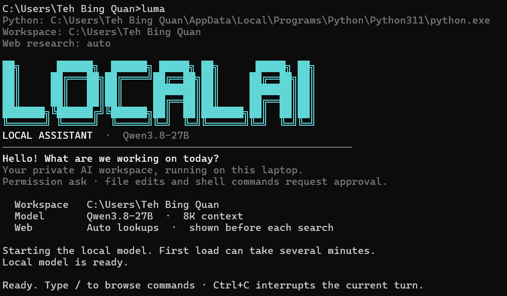

# Local Assistant

A private, local-first coding agent that runs entirely on your laptop. A small Python controller supplies workspace tools, mediates writes and commands, and talks to a local CUDA-enabled `llama.cpp` inference server. No cloud model, no API key, no Ollama required.



## Quick start

1. **Install the terminal command** (one-time):
   ```powershell
   powershell -ExecutionPolicy Bypass -File .\scripts\install-command.ps1
   ```
   Reopen your terminal, then type `luma` from any folder to start the assistant with that folder as the workspace.

2. **Or double-click** `Start Assistant.bat` to work in this project folder.

3. **Or run directly**:
   ```powershell
   .\scripts\start-agent.ps1 -WorkspacePath "C:\path\to\project"
   ```

The agent needs **Python 3.11+** (standard library only). The model loads when the agent starts and may take a moment. Type `/help` for CLI commands and `/exit` to stop.

## Supported models

The assistant auto-detects the active model and adjusts inference parameters (reasoning, temperature, sampling) accordingly.

| Model | Size | VRAM fit (6 GB) | Speed | Best for |
|:------|:-----|:---------------:|:-----:|:---------|
| **Qwen 2.5 Coder 7B Instruct** (default) | 4.4 GB | ✅ Full GPU | ~45 tok/s | Fast coding, tool calling, iterative development |
| **Qwen3.8-27B** | 16.4 GB | ⚠️ Partial (CPU offload) | ~2 tok/s | Deeper reasoning on complex questions |

The launcher defaults to **Qwen 2.5 Coder 7B** when present, falling back to Qwen3.8-27B. Override with `-ModelPath`:

```powershell
luma -ModelPath "C:\path\to\any-model.gguf"
```

### Download models

```powershell
# Qwen 2.5 Coder 7B (recommended, ~4.4 GB)
.\scripts\download-coder-7b.ps1

# Qwen3.8-27B (optional, ~16.4 GB)
.\scripts\download-model.ps1

# Qwen3.8-27B MTP draft (optional speculative decoder)
.\scripts\download-model.ps1 -MTP
```

## What it can do

- **Inspect a workspace** — `list_files`, `read_file`, and literal `search_text`.
- **Propose file changes** — creation, replacement, and deletion. The CLI prints a diff; approval follows the active `/permission` mode.
- **Run PowerShell commands** — the full command and working directory are shown; approval depends on `/permission`.
- **Web research** — automatic DuckDuckGo lookups when useful. Each web action is shown in the terminal. Use `/web off` for a fully offline session.
- **Session controls** — `/new` resets the conversation, `/workspace` shows the active folder, `/model` inspects the active model and context, `/cls` clears the terminal, `/effort` tunes reasoning depth, `/permission` sets tool approvals.

## Permission modes

| Mode | File changes | Shell commands |
|:-----|:-------------|:---------------|
| `/permission ask` (default) | Ask before each change | Ask before each command |
| `/permission workspace` | Auto-apply after showing diff | Ask before each command |
| `/permission full` | Auto-apply without prompts | Run without prompts |

File tools stay inside the selected workspace. Shell commands run as your Windows account and can affect files outside the workspace. Use `/permission ask` to restore prompts.

## Runtime tuning

```powershell
# Use a smaller context if memory is tight
luma -ContextLength 4096

# Adjust reasoning (applies to reasoning-capable models)
luma -ReasoningEffort high -ThinkingBudget 1024

# Fully offline session
luma -DisableWeb
```

During a session, use `/effort none|low|medium|high` or `/effort budget N` (0–8192) to tune reasoning interactively.

## Architecture

```
┌─────────────────────────────────────────────────┐
│  Terminal UI (terminal.py)                      │
│  Slash commands · ANSI rendering · Tab complete │
├─────────────────────────────────────────────────┤
│  Agent Loop (agent.py)                          │
│  System prompt · Tool dispatch · History trim   │
│  Qwen XML tool-call parser · Stream printer     │
├──────────────────────┬──────────────────────────┤
│  Workspace Tools     │  Web Tools (web.py)      │
│  (workspace.py)      │  DuckDuckGo search       │
│  File CRUD · Search  │  HTTPS page extraction   │
│  PowerShell runner   │  SSRF protection         │
│  Permission gates    │                          │
├──────────────────────┴──────────────────────────┤
│  Runtime (runtime.py)                           │
│  llama-server lifecycle · OpenAI-compatible API │
│  Streaming SSE · Model auto-detection           │
│  Windows Job Object cleanup                     │
├─────────────────────────────────────────────────┤
│  llama.cpp (runtime/llama.cpp/)                 │
│  CUDA inference · loopback-only · API key       │
└─────────────────────────────────────────────────┘
```

## Security

- The inference server listens only on `127.0.0.1` using a temporary port and per-session API key.
- It runs in offline mode with the web UI and built-in server agent tools disabled.
- On Windows, the model server and assistant-run commands are attached to a Job Object — closing the CLI window stops everything.
- Conversation history is kept in memory only and discarded on exit.
- Common secrets (`.env`, SSH keys, credentials) and binary files are excluded from file tools.
- Fetched files and web pages are treated as untrusted data and cannot change permissions.

## Project structure

```
local-desktop-assistant/
├── local_assistant/          # Python agent package (stdlib only)
│   ├── __main__.py           # CLI entry point and argument parsing
│   ├── agent.py              # Tool-calling agent loop
│   ├── runtime.py            # llama.cpp server lifecycle and streaming
│   ├── terminal.py           # Terminal UI, welcome screen, input
│   ├── web.py                # Web search and page extraction
│   └── workspace.py          # File tools and permission gates
├── scripts/
│   ├── start-agent.ps1       # Main launcher
│   ├── start-cli.ps1         # Plain chat (no tools) launcher
│   ├── install-command.ps1   # Install `luma` terminal command
│   ├── download-model.ps1    # Download Qwen3.8-27B
│   └── download-coder-7b.ps1 # Download Qwen 2.5 Coder 7B
├── models/                   # Local model files (git-ignored)
├── runtime/                  # llama.cpp binaries (git-ignored)
├── docs/                     # Design notes and benchmarks
├── AGENTS.md                 # Repository guidance for AI agents
├── Start Assistant.bat       # Double-click launcher
└── .gitignore
```

## Hardware tested on

- **CPU**: AMD Ryzen 5 7640HS
- **RAM**: 32 GB DDR5
- **GPU**: NVIDIA GeForce RTX 4050 Laptop GPU (6 GB VRAM)
- **OS**: Windows 11

See [model-setup.md](docs/model-setup.md) and [agent-harness.md](docs/agent-harness.md) for detailed benchmarks and design decisions.

## License

This project is provided as-is for personal and educational use.
