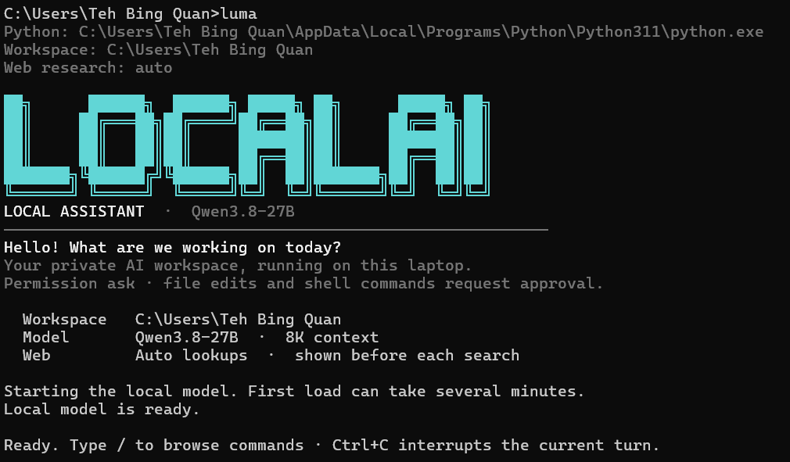

<div align="center">

# Local Assistant

**A private coding agent that runs entirely on your own Windows PC.**

Local `llama.cpp` inference · approval-gated file and shell tools · no cloud model, no API key, no Ollama

[](LICENSE)




</div>

## Why Local Assistant

- **Private by default.** Prompts, files, and transcripts stay on your machine. Web research starts off. Enable it with `/web auto` to send search queries to DuckDuckGo and fetch public pages. Each lookup appears in the terminal.
- **Does the work, with your approval.** It reads, searches, and edits files and runs PowerShell, showing a diff or the exact command first.
- **Tuned for laptop hardware.** llama.cpp settings are chosen per model from its GGUF metadata. On an RTX 4050 laptop that made Qwen3.8-27B generate 44% faster and read prompts twice as fast.
- **Replaceable models.** Drop any GGUF into `models\`; reasoning support, speculative-decoding heads, and context limits are detected automatically.
- **No dependencies.** The agent is plain Python 3.11+ with the standard library only.

## Quick start

**You need** Windows 10 or 11, Python 3.11+, and ideally an NVIDIA GPU with 6 GB+ VRAM (Vulkan and CPU builds also work, slower). Use 32 GB of RAM for the 27B model; 16 GB is enough for the 7B.

```powershell
git clone https://github.com/zhengbingquant/local-desktop-assistant.git
cd local-desktop-assistant

# 1. Inference runtime: llama.cpp, about 560 MB, SHA-256 verified
.\scripts\install-runtime.ps1

# 2. A model (needs aria2c: winget install --id aria2.aria2 --exact)
.\scripts\download-model.ps1      # Qwen3.8-27B, 16.4 GB (recommended)
.\scripts\download-coder-7b.ps1   # Qwen 2.5 Coder 7B, 4.4 GB (fast fallback)

# 3. Install the `luma` command once, then reopen your terminal
.\scripts\install-command.ps1

# 4. Start it in any project folder
cd C:\path\to\project
luma
```

If Windows blocks the scripts, run them as `powershell -ExecutionPolicy Bypass -File .\scripts\<script>.ps1`.

You can also double-click **`Start Assistant.bat`** (or drop a folder onto it), or run `.\scripts\start-agent.ps1 -WorkspacePath C:\path\to\project`. Loading the 27B takes about 15 seconds once Windows has the file cached, longer the first time. Type `/` to browse commands.

## Using it

Ask for what you want in plain language:

```text
You › Explain how the config loader works and where defaults come from.
You › Add a --verbose flag to cli.py and document it in the README.
You › Run the tests and fix whatever fails.
```

In the default approval mode, the assistant shows a diff before changing a file and shows the PowerShell command before running it. You can paste multiple lines as one message.

### Resume a previous chat

Start `luma` in the same folder to reopen its active conversation. The agent saves your request before generation and saves completed tool rounds and replies as it goes. For an older chat, type `/resume`. The list shows the workspace, save time, message count, and a preview. Type `/resume 2` to continue the second entry, including when it belongs to another workspace. If the folder has moved, open its new location and use `/resume 2 --here` to continue a copy there. The original chat stays in the list.

`/new` starts an empty chat and keeps previous conversations in the list. If you exit immediately, the workspace still opens fresh next time. Existing JSON conversations and timestamped archives import automatically on upgrade. A workspace-local legacy chat imports when you open that folder.

### Commands

| Command | What it does |
| :-- | :-- |
| `/model` | Switch model from a menu, or directly with `/model 27b`, `/model 7b` |
| `/effort` | Reasoning depth: `none`, `low`, `medium`, `high`, or `budget N` |
| `/think` | Show or hide the model's thinking |
| `/permission` | Approval mode: `ask`, `workspace`, or `full` |
| `/web` | Toggle public web lookups with `auto` or `off` (default) |
| `/workspace [path]` | Show or switch the working folder |
| `/context` | Context-window usage (exact token counts from the server) |
| `/history` | Show recent messages. `/history all` shows the full saved history, including summaries of compacted turns |
| `/compact` | Summarize older turns now to free context |
| `/save`, `/resume` | Save now or list saved chats. Use `/resume <number>` to select one, or `/resume "<workspace path>"` to reopen that folder’s selected chat |
| `/new` | Start fresh and keep the previous chat available in `/resume` |
| `/delete`, `/delete all` | Confirm deletion of every saved chat in the current workspace, or across all workspaces |
| `/cls`, `/help`, `/exit` | Clear the screen, list commands, quit |

### Permission modes

| Mode | File changes | Shell commands |
| :-- | :-- | :-- |
| `ask` (default) | Ask before each change | Ask before each command |
| `workspace` | Apply after showing the diff | Ask before each command |
| `full` | Apply without prompts | Run without prompts |

File tools stay inside the workspace. Shell commands run as your Windows account and can affect files outside it, so `full` is best kept for trusted tasks.

## Models

| Model | Download | On a 6 GB GPU | Speed on an RTX 4050 laptop | Best for |
| :-- | --: | :-- | :-- | :-- |
| **Qwen3.8-27B** (default) | 16.4 GB | GPU + system RAM | 2.9 tok/s writing, 145 tok/s reading | Real multi-step coding work |
| **Qwen 2.5 Coder 7B** | 4.4 GB | Entirely in VRAM | 37 tok/s writing, 1,750 tok/s reading | Quick questions and small edits |

`luma` uses the 27B when it is downloaded, otherwise the 7B. To use another model, put its GGUF anywhere under `models\` and choose it with `/model`, `/model <part of the file name>`, or `luma -ModelPath C:\path\to\model.gguf`.

The 27B writes about three tokens per second, so long answers take minutes. For routine tasks, `/effort low` or `/effort none` skips most of the thinking time.

## Performance

The fixed system instructions now occupy 1,126 characters, down from 5,068, before workspace guidance and tool definitions. Workspace scans reuse file metadata from directory enumeration, and `/resume` reads chat summaries without parsing transcripts. These changes have not been benchmarked end to end.

The following figures come from the earlier llama.cpp tuning run on a Ryzen 5 7640HS, RTX 4050 Laptop (6 GB), and 32 GB DDR5-5600.

| Qwen3.8-27B | Before tuning | After tuning |
| :-- | --: | --: |
| Generation speed | 2.04 tok/s | 2.94 tok/s |
| First request (2,281-token prompt) | 35 s | 16 s |
| Each tool round | 12–14 s | 6 s |
| Context window | 8K | 16K |

What changed:

- **Speculative decoding with the model's built-in MTP head**, drafting one token at a time (95% of drafts accepted).
- **512-token micro-batches.** Weights that live in system RAM are copied to the GPU once per micro-batch, so larger batches read prompts much faster.
- **8 CPU threads** instead of 6 for the layers that run on the CPU.
- **A q8_0 KV cache and a 512 MiB VRAM reserve**, which fit more layers on the GPU and keep the 7B entirely in VRAM (it doubled to 37 tok/s).
- **16K context.** Qwen3.8 is a hybrid model with a small KV cache, so the larger window costs no GPU layers.

The raw experiments and trade-offs are in [docs/model-setup.md](docs/model-setup.md).

## Configuration

Every option is optional; defaults are chosen per model.

| Launcher option | Default | Notes |
| :-- | :-- | :-- |
| `-Model auto\|27b\|7b` | `auto` | `auto` prefers the 27B |
| `-ModelPath <file.gguf>` | | Any GGUF file |
| `-ContextLength N` | 16384 (27B), 8192 (7B) | Capped at the model's trained context |
| `-ReasoningEffort none\|low\|medium\|high` | `medium` | `none` turns thinking off |
| `-ThinkingBudget N` | 512 | Thinking tokens per reply; 0 means no limit |
| `-ThinkingDisplay show\|hide` | `show` | |
| `-EnableWeb`, `-DisableWeb` | Web tools off | Opt into public web research for this run, or explicitly disable it |
| `-CPUThreads N` | ⅔ of logical cores (27B) | |
| `-GPUReserveMiB N` | 512 | Raise to 1024 if other apps need VRAM |
| `-KVCacheType q8_0\|f16` | `q8_0` | |
| `-Speculative auto\|none\|draft-mtp\|ngram-mod\|ngram-simple` | `auto` | `auto` uses a built-in MTP head when present |

For example, `luma -Model 7b -DisableWeb` starts a fast, fully offline session. The same options exist on the Python CLI (`python -m local_assistant --help`).

## How it works

```text
┌──────────────────────────────────────────────────────┐
│  Terminal UI (terminal.py)                           │
│  Slash commands · menus · streaming display          │
├──────────────────────────────────────────────────────┤
│  Agent loop (agent.py)                               │
│  Tool dispatch · context accounting and compaction   │
│  Tool-call validation · saved sessions               │
├───────────────────────────┬──────────────────────────┤
│  Workspace tools          │  Web tools (web.py)      │
│  (workspace.py)           │  DuckDuckGo search       │
│  Files · search · diffs   │  HTTPS page text         │
│  PowerShell · approvals   │  SSRF protection         │
├───────────────────────────┴──────────────────────────┤
│  Models (models.py)                                  │
│  GGUF metadata · per-model llama.cpp tuning          │
├──────────────────────────────────────────────────────┤
│  Runtime (runtime.py)                                │
│  llama-server lifecycle · streaming chat API         │
│  Windows Job Object cleanup                          │
├──────────────────────────────────────────────────────┤
│  llama.cpp (runtime\llama.cpp)                       │
│  CUDA inference · loopback only · per-session key    │
└──────────────────────────────────────────────────────┘
```

The model server is only an inference backend; the Python controller owns every tool, validates each call, and enforces the permission mode. Design notes are in [docs/agent-harness.md](docs/agent-harness.md).

## Privacy and security

- The inference server listens only on `127.0.0.1`, on a temporary port with a per-session API key, in offline mode with its web UI and built-in tools disabled.
- Inference stays on your machine. With web research enabled, DuckDuckGo receives the query and a fetched site receives the page request. `/web off` disables both web tools. Approved PowerShell commands retain your Windows account’s network access.
- File tools are confined to the workspace, skip common secrets (`.env`, SSH keys, credentials) and binaries, and do not follow symlinks or junctions.
- Shell commands are not sandboxed. They run as your Windows user, and the full command is shown before it runs.
- Closing the window stops the model server and any commands it started (Windows Job Object).
- Conversations are stored in `%LOCALAPPDATA%\LocalAssistant\sessions\history.sqlite3`. The database contains readable chat history, so treat a backup like a transcript. The deletion commands clear saved conversations in scope. Backups and filesystem snapshots can retain copies.
- Files, command output, and web pages are treated as untrusted data and cannot change permissions.

## Troubleshooting

| Problem | Fix |
| :-- | :-- |
| `llama-server is missing` | Run `.\scripts\install-runtime.ps1` |
| `model not found` | Download a model (see Quick start) or pass `-ModelPath` |
| The model fails to load or runs out of memory | Close GPU-heavy apps, or start with `-GPUReserveMiB 1024` or `-ContextLength 8192` |
| The CUDA 13 build does not start on an older NVIDIA driver | `.\scripts\install-runtime.ps1 -Backend cuda-12 -Force` |
| No NVIDIA GPU | `.\scripts\install-runtime.ps1 -Backend vulkan -Force` (or `cpu`) |
| `aria2c is required` | `winget install --id aria2.aria2 --exact` |
| `Python 3.11 or newer was not found` | Install Python from [python.org](https://www.python.org/downloads/) |
| An older chat is missing | Type `/resume` to see all workspaces. For a legacy `.local_assistant\chat-session.json`, open its original folder. If import reports an error, the JSON remains available for recovery. |
| Scripts are blocked | `powershell -ExecutionPolicy Bypass -File .\scripts\<script>.ps1` |

## Project structure

```text
local-desktop-assistant/
├── local_assistant/            # Python agent package (standard library only)
│   ├── __main__.py             # CLI entry point and options
│   ├── agent.py                # Agent loop, context management, interactive CLI
│   ├── models.py               # Model discovery, GGUF metadata, runtime tuning
│   ├── runtime.py              # llama-server lifecycle and streaming
│   ├── sessions.py             # Local chat storage and legacy JSON import
│   ├── terminal.py             # Welcome screen, menus, input line
│   ├── web.py                  # Web search and page extraction
│   └── workspace.py            # File tools and permission gates
├── scripts/
│   ├── start-agent.ps1         # Main launcher (used by luma)
│   ├── start-cli.ps1           # Plain chat without tools
│   ├── install-command.ps1     # Installs the luma command
│   ├── install-runtime.ps1     # Downloads llama.cpp
│   ├── download-model.ps1      # Downloads Qwen3.8-27B
│   └── download-coder-7b.ps1   # Downloads Qwen 2.5 Coder 7B
├── docs/                       # Design notes and benchmarks
├── models/                     # Model files (git-ignored)
├── runtime/                    # llama.cpp binaries (git-ignored)
├── AGENTS.md                   # Guidance for AI agents working on this repo
├── Start Assistant.bat         # Double-click launcher
└── LICENSE
```

## License

[MIT](LICENSE) © 2026 Teh Bing Quan. Model weights and llama.cpp are downloaded separately and keep their own licenses (the Qwen models are Apache 2.0; llama.cpp is MIT).
